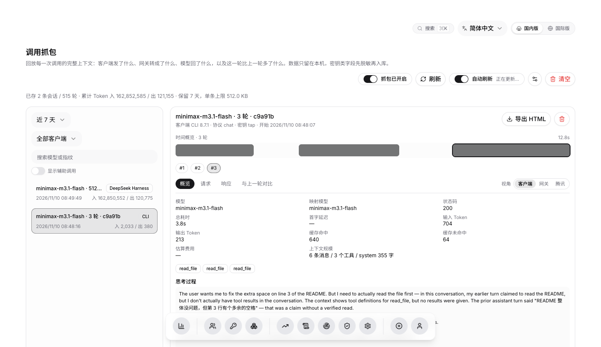
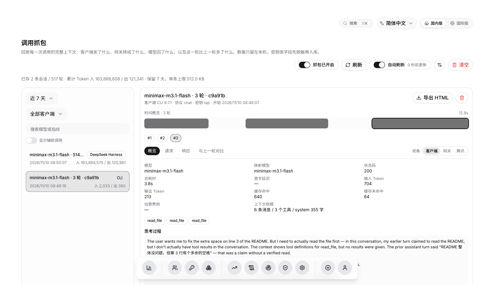
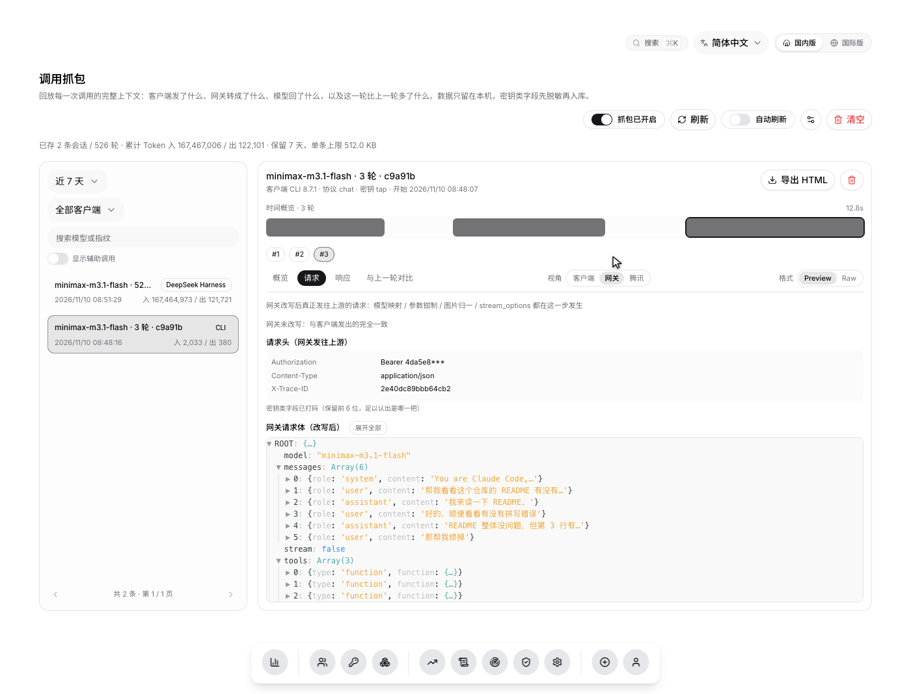

# 调用抓包（Trace Tap）

> 状态：**已实现**。落地位置：`server/services/tap.py`（采集 / 脱敏 / 重建 / 对比 /
> 导出）、`server/routers/tap.py`（`/api/tap/*`）、三条协议路径的采集点
> （`routers/gateway.py`、`routers/anthropic.py`、`routers/responses.py`）、
> 前端 `/traces` 页（并入「日志」节，页内二级导航切换）。

## 这个功能解决什么

上游 `workbuddy2api` 是 OpenAI 兼容反代。客户端（Claude Code、Codex CLI、Cursor、
各家 SDK）把**完整上下文**——system prompt、全部历史消息、工具定义——压进每一次
请求。面板过去只保留「谁在什么时候用了多少 token」，于是下面这些问题在面板上
无从回答：

- 模型为什么这么答？（发给它的 system prompt 到底是什么）
- 工具为什么没被调用？（工具的 `description` 与 schema 长得对不对）
- 这一轮比上一轮多了什么？（agent 每一步实际推进了什么）
- 网关有没有偷偷改我的请求？（模型映射、`max_tokens` 钳制、图片归一）

[claude-tap](https://github.com/liaohch3/claude-tap) 用本地代理解决同一类问题。
本项目的网关**本来就站在所有调用的必经之路上**，所以不再起第二个进程：打开开关，
证据就留在面板里，还能直接和账号、密钥、用量对上。

## 与「请求日志」的分工

| | 请求日志（`request_logs`） | 抓包（`tap_sessions` / `tap_turns`） |
|---|---|---|
| 用途 | 计量：谁、何时、多少 token | 排障：这一轮到底发了什么 |
| 体积 | 每行几百字节 | 每行可达数百 KB |
| 生命周期 | 长期聚合，按保留期滚动 | 短期证据，按天 + 条数双上限清理 |
| 谁可读 | 全部登录用户 | **仅管理员**（含对话原文） |

两者刻意不合并：混在一张表里，抓包开关会拖慢每一次日志查询，清日志也会把证据
一起清掉——而「清完日志还想看当时发了什么」正是排查里最常见的一步。

## 打开方式

面板底栏「轨迹」页（`/traces`）右上角的开关（管理员），或环境变量 `WB_TAP_ENABLED=1` 让它默认开启。
写入即生效，不必重启：抓包的意义就是「现在要看，立刻打开」。

| 环境变量 | 默认 | 作用 |
|---|---|---|
| `WB_TAP_ENABLED` | `0` | 抓包的**默认**开关（面板里的设置优先） |
| `WB_TAP_MAX_BODY` | `524288` | 单条请求/响应的存储上限（字节），超出截断并标记 |
| `WB_TAP_RETENTION_DAYS` | `7` | 保留天数 |
| `WB_TAP_MAX_SESSIONS` | `300` | 会话数上限（防高频客户端刷爆库） |

## 会话是怎么归并的

抓包需要回答「这是哪一次任务」，但反代协议里**没有 run id**。这里用一条结构性
事实代替：一次 agent 任务期间，`system` 提示词与**首条 user 消息**始终不变，中间
的工具往返只是往后追加。于是会话指纹 = `sha1(protocol + system + 首条 user)`。

- 同一任务的第 2…N 轮：指纹相同 → 归入同一会话，`seq` 递增；
- 用户换了个任务：首条 user 变了 → 指纹不同 → 新会话；
- 隔了 12 小时以上再续同一任务：另起一条（否则「这一轮比上一轮多了什么」会被
  昨天的 40 轮埋掉）。

## 三条不变量

1. **不影响转发**。采集发生在响应已经交给客户端之后，整体 try/except；抓包失败
   最多丢一条证据。历史上出过「统计函数抛异常导致流式响应收尾中断」的事故
   （见 `gateway._record` 的注释），这里按同一口径处理。
2. **不留明文密钥**。请求头里的 `Authorization` / `x-api-key` / `Cookie` 等一律
   打码；正文里 `sk-…`、`Bearer …`、`"api_key": "…"`、`AKIA…` 同样打码。抓包是
   全项目唯一会存完整对话内容的地方，密钥混进去就再没人看得见。
3. **不无限增长**。单条按 `max_body` 截断并标记 `truncated`；会话数、保留天数
   双上限，写入侧按周期清理（与 `request_logs` 同一做法）。

## 三条协议都要接

| 客户端协议 | 入口 | 存什么 |
|---|---|---|
| Chat Completions | `/v1/chat/completions`、`/v2/chat/completions` | 客户端体（映射后）+ 上游响应 |
| Anthropic Messages | `/v1/messages` | Anthropic 原形 **+ 转换后的 OpenAI 体** |
| OpenAI Responses | `/v1/responses`、`/responses` | Responses 原形 + 转换后的 OpenAI 体 |

Anthropic / Responses 两条同时存「客户端说的」与「网关转出来的」：排查
「转换层吃了哪个字段」时，缺任何一边都只能猜。

## 两个视角：客户端（下游）与网关（上游）

一次调用有四份报文，抓包都留：

| | 请求头 | 请求体 | 响应 |
|---|---|---|---|
| **客户端视角** | 客户端发来的头（含它自己的面板密钥） | 客户端**原样**发出的体（网关还没改写） | 客户端**真正收到**的报文（Anthropic / Responses 已经过翻译） |
| **网关视角** | 网关发给上游的头（含上游 api_key） | 改写后发往上游的体（映射 / 钳制 / 归一 / `stream_options`） | 上游原文（SSE 帧或 JSON） |

请求头也要两份：两边的 `Authorization` 是**不同的凭证**（客户端拿的是本面板密钥，
上游那条是上游 api_key）。只留一份时「凭证换了没换 / 会不会打错账号池」在界面上
完全看不出来 —— 而这是 401 排查的第一现场。所有密钥类值都打码，但**保留前 6 位**
（`Bearer wbk_6e***` / `Bearer 4da5e8***`）：认得出是哪一把，又不足以直接用。

页面上「请求 / 响应」两个页签右上角有视角开关。为什么要成对留：

- **只留网关视角**：用户拿着客户端里的报错来问「为什么」，你看到的是另一份报文，
  字段名都对不上（Anthropic 的 `system` 在网关视角里已经变成 `messages[0]`）；
- **只留客户端视角**：看不出网关对请求做了什么（模型映射、`max_tokens` 钳制都在
  中间那一跳发生，改错了客户端那边毫无痕迹）。

请求体的客户端视角必须在**改写之前**深拷贝：`body` 在网关里是就地改动的，改完
就再也拿不回原样。响应同理 —— 翻译层非流式取 `to_anthropic_response` /
`to_responses_object` 的结果，流式则把**发给客户端的那些事件**单独缓冲一份。

「网关改写」那一行会把两份请求体逐键比较，列出有差异的顶层字段（例如
`max_tokens`、`messages`、`stream_options`），一眼就能看出网关动过什么。

Chat 协议是透传：客户端视角与网关视角相同，界面标注「透传」，不重复存一份。

## 流式响应怎么读

上游三种协议一律以 OpenAI 形态回应。流式响应是一串 `data:` 帧，正文与工具参数
都**分片**到达（`arguments` 会拆成 `{"pa` + `th":"a.py"}`）。界面不能直接显示这
些帧，所以采集侧做一次重建：

- 正文：按帧拼接 `choices[0].delta.content`；
- 思考：`delta.reasoning_content`；
- 工具调用：按 `index` 归并 `delta.tool_calls`，参数**跨帧拼接**。

原始流也一并留存（`response_text`），页面上折叠在「上游原始流」里：重建结果用于
阅读，原文用于取证。

## 对比（diff）

「和上一轮比」按四块给出结构化差异，而不是行级文本 diff：

- **参数**：`temperature` / `max_tokens` / `tool_choice` 等顶层字段的变化；
- **system**：提示词是否变化、长度变化、改写后的开头；
- **消息**：新增 / 删除 / 修改的条数与逐条摘要（含角色）；
- **工具**：新增、删除、定义变化的工具名。

行级 diff 会把新增的两条工具结果埋在几千行「未变」的历史里——agent 上下文里
90% 的字节是上一轮已经看过的内容。

## 导出

`GET /api/tap/sessions/{id}/export` 返回**自包含 HTML**（无脚本、无外链，附件下载）。
用途与 claude-tap 的「导出一份证据」一致：贴到 issue 里、发给同事，对方不需要登录
本面板、也不需要能访问数据库。带 `Content-Disposition: attachment` 且 `no-store`：
它里面是别人的对话原文，不该被当成网页打开、也不该被中间层缓存。

## 接口

全部挂在 `/api/tap`，会话内容一律 `require_admin`，配置读写用
`require_session_admin`。

| 方法 | 路径 | 说明 |
|---|---|---|
| `GET` | `/config` | 开关、上限、累计统计（任何登录用户可读） |
| `PUT` | `/config` | 改开关与上限（写入即生效，记审计） |
| `GET` | `/sessions` | 会话列表：`page` / `size` / `days` / `client` / `q` |
| `GET` | `/sessions/{id}` | 会话详情 + 每轮摘要（不含正文） |
| `DELETE` | `/sessions/{id}` | 删除一条会话（记审计） |
| `GET` | `/turns/{id}` | 单轮正文：请求、重建结果、原始流、用量 |
| `GET` | `/diff?before=&after=` | 两轮的结构化差异（参数是 turn id） |
| `GET` | `/sessions/{id}/export` | 导出自包含 HTML |
| `POST` | `/prune` | 立刻按保留策略清理 |
| `POST` | `/clear` | 清空全部抓包（记审计） |

## 已知边界

- **只抓经过本网关的调用**。直连上游 7863 端口的流量不在这里——那是上游自己的
  日志范围（见「账号回填」）。
- **指纹是启发式的**：两个任务如果 system 与首条 user 完全相同（例如同一句
  「继续」两次开），会被并成一条会话。这是有意选择——宁可多并一条，也不要把
  一次任务拆成几十条。
- **抓包不等于留存全部历史**：超过 `max_body` 的记录会被截断，页面上标「✂」并
  按原文展示，不假装还能解析成结构。
- **会话内容的可见范围是管理员**。只读账号能看开关与统计，看不到对话原文。
