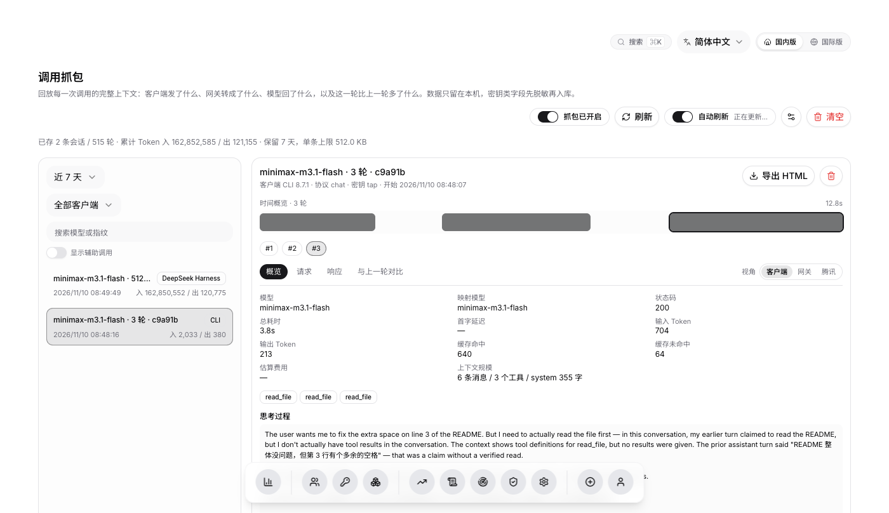
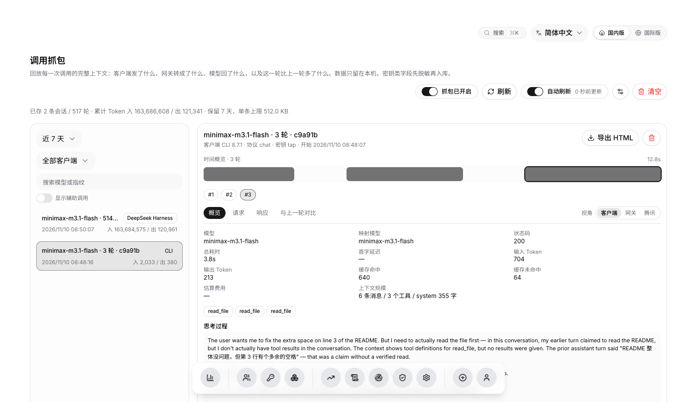
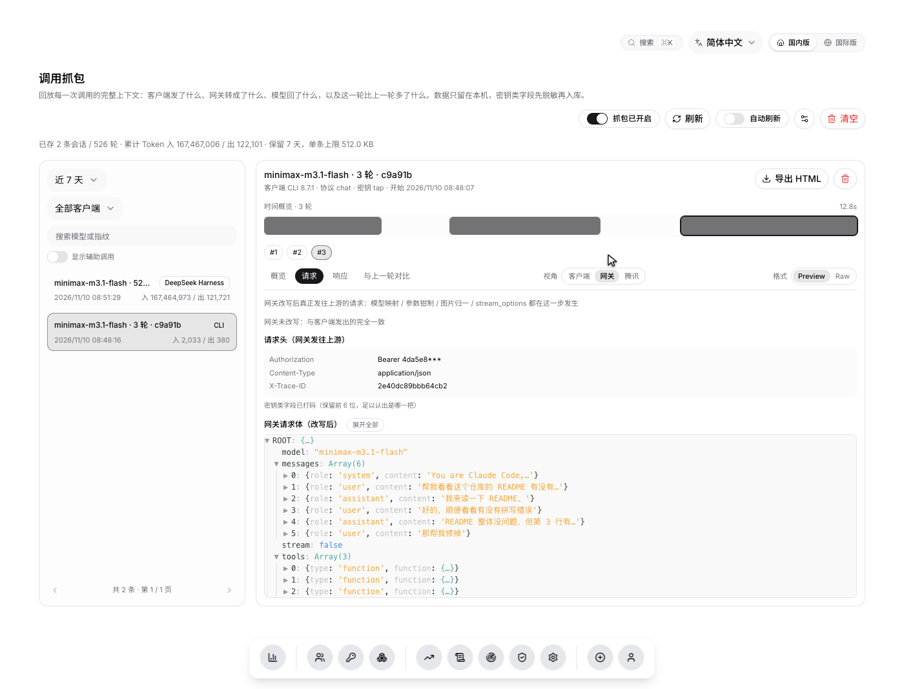
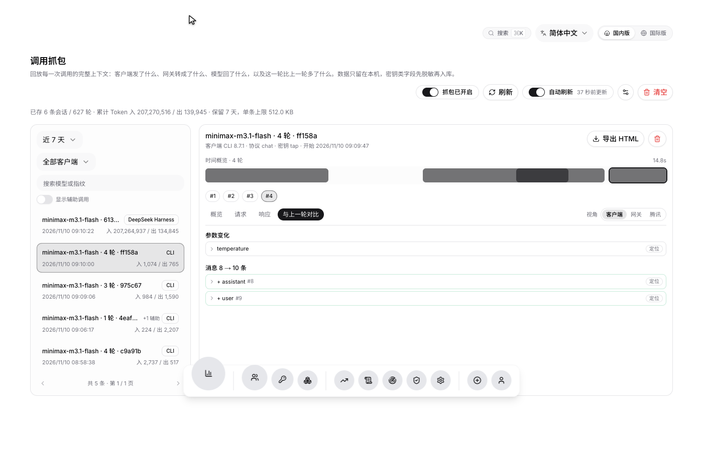
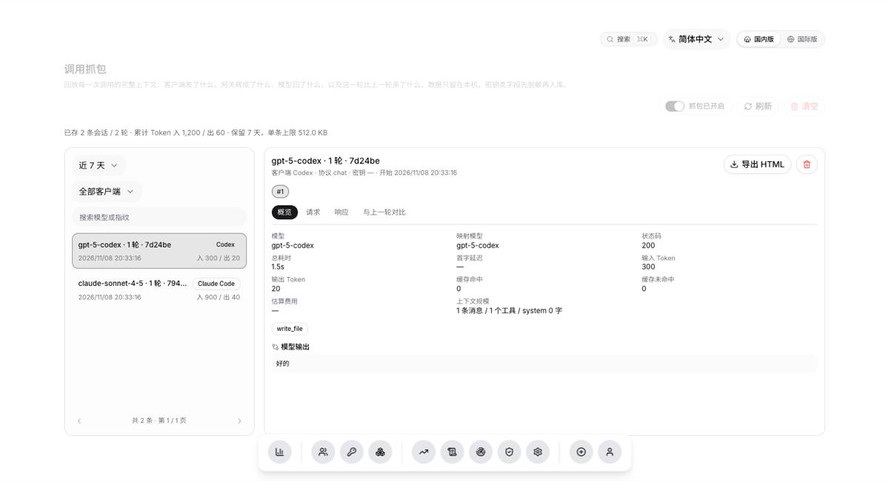
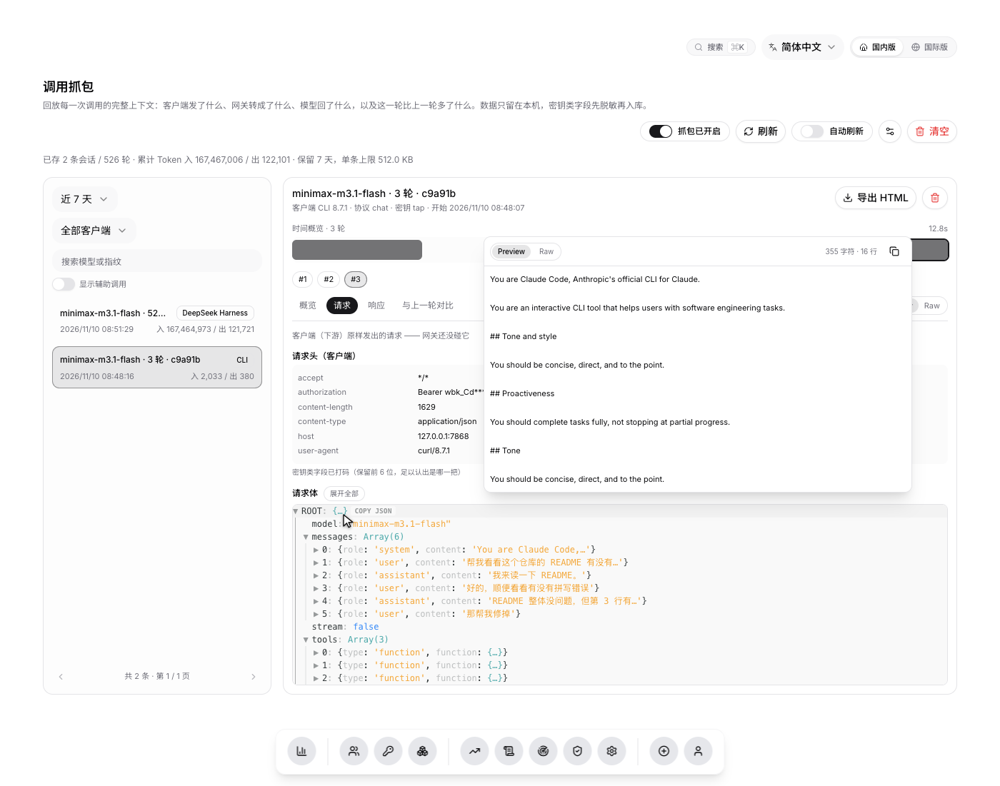
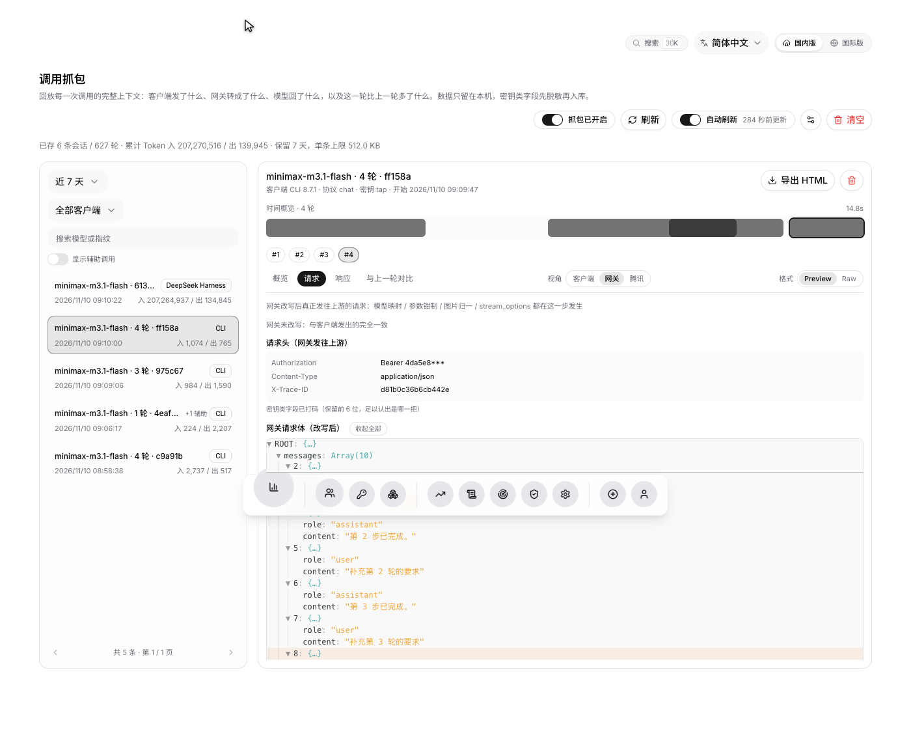
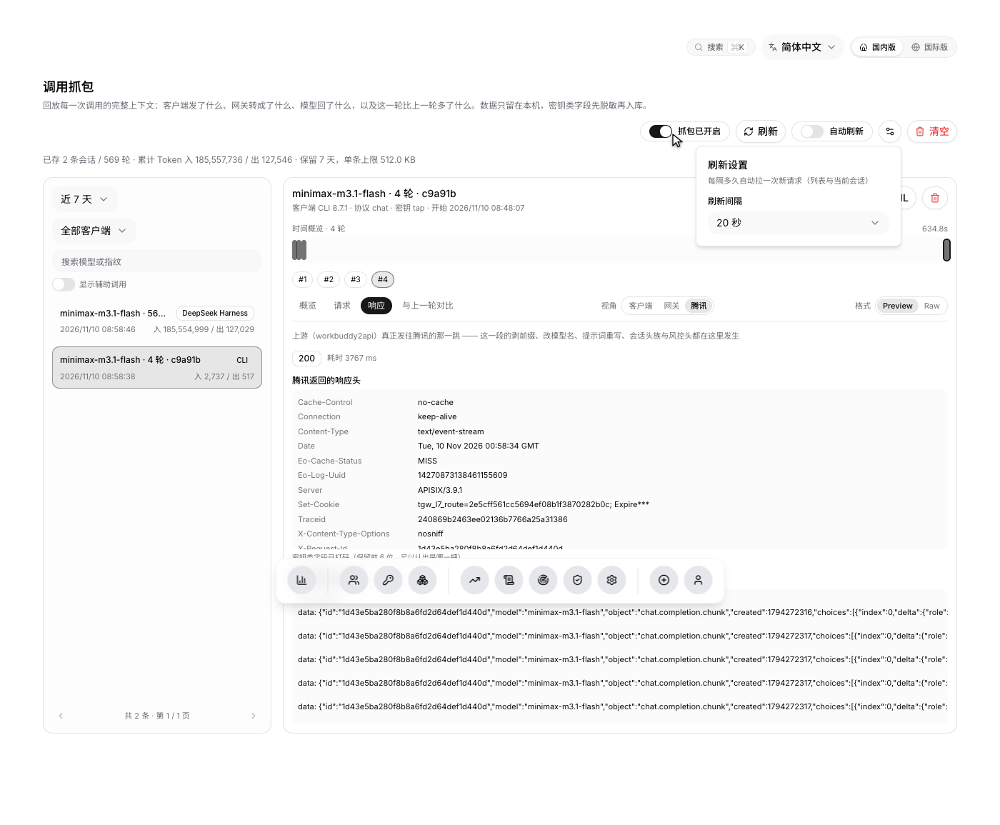
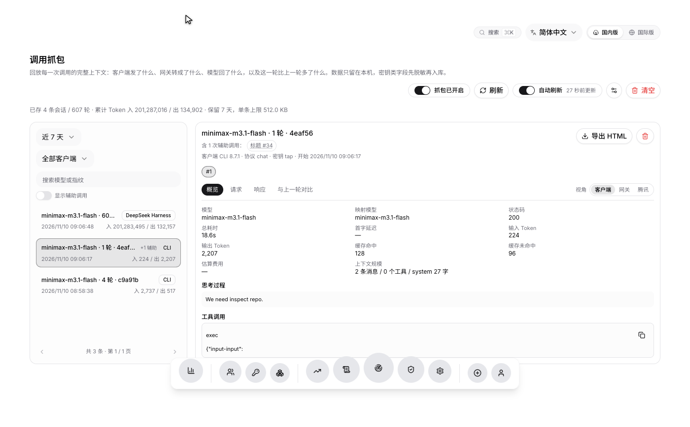

# 界面预览（全部截图）

> 从 README 拆出来的一节，截图与说明不变。

### 仪表盘
> 账号健康度、上游连接状态、近 14 天调用趋势

<b>深色模式</b>（点击展开）

### 轨迹（调用抓包）

> 一次 agent 任务里的每一轮请求与响应；客户端名与版本、上下文规模、工具清单一屏看完

<b>客户端视角 / 网关视角 / 与上一轮对比</b>（点击展开）

客户端视角：客户端**原样**发出的请求头与请求体（密钥类字段打码，保留前 6 位以便认出是哪一把）

网关视角：网关改写后发往上游的请求，顶部列出被改写的字段（模型映射、`max_tokens` 钳制、`stream_options` 注入…）

与上一轮对比：新增 / 修改的消息逐条列出，参数、system、工具变化分块显示

底栏第 7 个图标即「轨迹」，与日志 / 统计同级

<b>长字符串浮窗 / 定位 / 自动刷新</b>（点击展开）

长字符串悬停浮窗：system prompt、工具描述这类几千字的内容，悬停即看全文。Preview 按**真实换行**渲染，Raw 是转义原文

差异「定位」：点一下直接跳到请求页，展开沿途节点并滚到差异所在的那一行（橙色高亮）

齿轮里调自动刷新的间隔（默认 20 秒，存在浏览器本地）；关掉自动刷新后新轮次到达时只给一条提示，不抢当前正在看的那一轮

辅助调用（会话标题生成 / 上下文压缩）挂回主会话：列表里是「+1 辅助」，详情里能点进去看

### 账号管理
> Token 有效期按剩余时间分档着色（已过期 / 即将过期 / 偏紧 / 健康）

<b>扫码添加账号</b>（点击展开）

### 任务记录
> 签到结果、上游原始日志、自动任务与积分收益集中一页（30 秒自动刷新）

### API 密钥
> 限定版本（国内版 / 国际版）、独立配额、IP 限制、模型白名单，明文仅创建时展示一次

### 请求日志
> 按时间 / 密钥 / 状态 / 模型 / IP 筛选，含**实际调用账号**、**首字延迟**、总耗时、Token 计量与**提示词缓存命中**

「首字」= 从发起上游请求到收到第一个含正文的 delta，反映**上游响应快慢**；
「总耗时」含模型生成全程，回答越长越大，用于看单次请求的整体开销。
非流式请求没有中间过程，首字显示 `—`。

**账号**是这次调用实际落在哪个上游号上，形如 `张叔叔(299e342b)`。账号由上游选择、
也不在响应里回传，本面板是读上游的容器日志再按时间对回去的，所以**比请求晚几秒**
才补上（刚打完的请求可能还是 `—`）；容器日志读不到时（上游不在本机、没挂
`docker.sock`、原生部署）这一列一直是 `—`，不影响其余功能。

Token 后面的缓存标记（绿色「缓存 N%」/ 琥珀色「未命中」）来自上游返回的用量数据，
用来判断同一段前缀**有没有真的吃到缓存**——命中部分计费便宜得多。前缀缓存按账号存，
所以「换了账号」与「没命中」常常一起出现，配合账号列一起看。上游不返回这项数据时
标记不显示（详情里写「未采集」），与「没有命中」不是一回事。

### 用量统计
> 按天、按模型、按密钥多维统计 Token 消耗

### 模型中心
> 账号可用模型一览：显示名、上下文、最大输出、推理档位与系列分组

数据直连腾讯模型接口，因此有**显示名**和**推理档位**（上游 `/v1/models` 会丢掉这两项）。
顶部统计卡与列表全部由真实数据计算；来源取不到时回退上游简表并如实标注，不编造字段。

### 聊天测试台
> 不建密钥直接试调模型；真实模型选择、思考强度与实时积分消耗

请求经管理端登录态转发到上游（与下游同一账号池），**仅管理员可用**——
试调会真实扣积分。右下角显示本次会话累计消耗，每条回答下标注该次扣费与 token 数。

### 安全与 IP 管控
> 全局白/黑名单、CIDR 规则、访问审计与拦截记录

### 设置
> 上游配置可视化，中文说明 + 开关 / 数字框

---
