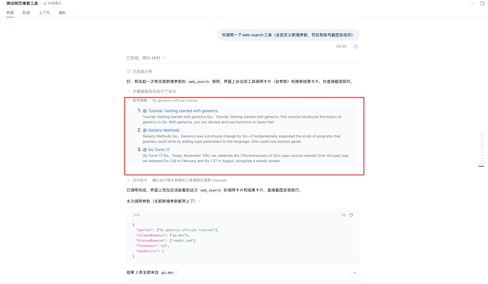
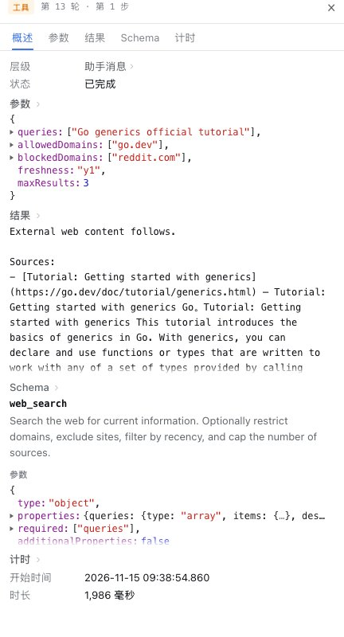

# Web 搜索透传（/v1/tools/search）

> 配套上游网关补丁：`dev/upstream-patches/0057-web-search-tool.patch`
> （wb2api-go 侧的 agenttool 搜索透传，账号池轮转 + 15001 配额冷却）。

## 这是什么

把下游客户端的 `web_search` 请求**原样转发**到上游网关的 agenttool 搜索端点
（`https://www.workbuddy.cn/agenttool/v1/search`）。manager 在这里只做代理：

```
下游（DSH / 任意 OpenAI 兼容客户端，wbk_ 密钥）
   │  POST {manager}:7864/v1/tools/search
   ▼
manager  ← 鉴权（_authorize）→ 按密钥解析上游（_upstream_for）→ 换上游 api_key 转发
   │  POST {wb2api-go}:7863/v1/tools/search
   ▼
wb2api-go  ← 账号池轮转（无粘性）→ 15001 配额软冷却换号 → 官方指纹头组发上游
   ▼
workbuddy.cn/agenttool/v1/search
```

价值：**一把密钥走全部数据面**——下游用同一把 wbk_ 密钥既调模型
（`/v1/chat/completions`）又调搜索，不用为搜索另立凭证；搜索调用自动进
面板的调用日志、轨迹抓包、密钥配额与多分组隔离体系。

## 协议

### 请求

```json
POST /v1/tools/search
Authorization: Bearer <wbk_ 密钥>
Content-Type: application/json

{
  "query": "搜索词（必填）",
  "type": "text2text",                    // 可选，固定值；上游 agenttool 请求类型
  "max_results": 5,                       // 可选，默认 5，1..20
  "allowed_domains": ["go.dev"],          // 可选，字符串数组；只返回这些域
  "blocked_domains": ["reddit.com"],      // 可选，字符串数组；网关拼成 " -site:x" 进 query
  "freshness": "d1"                       // 可选：d1 | m1 | y1（一天 / 一月 / 一年内）
}
```

> manager 对请求体的处理是**校验 + 原样转发**：`query` 非空、`type` 只能为
> `text2text`、`max_results` 为 1..20 整数、两个域名参数为字符串数组、
> `freshness` 属于 `d1|m1|y1`（空串等同不传）。非法参数在 manager 返回
> `400 invalid_search_params`，不消耗账号池搜索配额；合法 body 逐字段原样
> 转发（不重命名、不删字段），未知字段也放行以兼容后续 agenttool 扩展。
> `max_results` 的默认/兜底与 `blocked_domains` 的 `-site:` 拼接都在 0057
> 网关完成，manager 不改写 body（见调用日志与轨迹抓包：入站/出站同体）。
>
> 这道入站校验是**可选纵深护栏**：配套插件 `dsh-web-search-workbuddy` 已
> 在客户端侧完成参数构造与主校验（枚举、1..20 钳制、域名归一化、非法值
> 不发请求），路由从首版起就是 `json=body` 全量透传，单一可信插件链路
> 原本已足够；manager 侧校验主要面向绕过插件直连本端点的调用方。

### 响应（上游信封原样透传，不翻译）

```json
{
  "code": 0,
  "msg": "",
  "results": [{ "title": "...", "url": "...", "snippet": "..." }],
  "total_results": 3,
  "response_time_ms": 616,
  "provider": "1"
}
```

### 错误

| HTTP | 场景 | body 形态 |
|---|---|---|
| 400 | query 为空 / 非字符串 / body 非 JSON / 任一可选参数非法（type、max_results、allowed_domains、blocked_domains、freshness）→ `invalid_search_params` | OpenAI error 信封 |
| 401/403/429 | 密钥无效 / IP 拦截 / 频控（与 chat 同管线） | OpenAI error 信封 |
| 429 | **全池搜索配额耗尽**（上游 15001） | `{"error":"...quota...","code":"quota_web_search","tried":N}` |
| 200 + code≠0 | 上游其他业务码 | 上游信封原样（`code`/`msg` 字段，客户端自行路由） |
| 502 | 上游不可达 | OpenAI error 信封 + gateway_hint |
| 503 | 密钥绑定的上游分组不可用 | OpenAI error 信封 |

> 协议是「透传」不是「翻译」：非 15001 的业务码也原样透传（与 chat 的
> error-passthrough 同哲学）。结果的内容过滤（CLI 侧 `filterUnsafeResults`）
> **不在 manager 做**，由调用方决定。

## 鉴权口径

搜索没有模型维度，走与 `/v1/models` 相同的 `is_model_list=True` 鉴权：
**限定版本的密钥**（realm）与**启用模型白名单的密钥**在这种不带 model 的
数据面调用上不拦——真正的版本隔离由上游网关的账号池把关（realm 由账号侧
决定）。密钥停用 / 过期 / IP 规则 / 频控照常生效。

## 上游前置条件

manager 的这条路由只代理，**上游网关必须已应用 0057 补丁**（否则 404）。
给 wb2api-go 打补丁：

```bash
# 1. 取随发布包分发的源码快照（或现有部署树）
# 2. 应用补丁（补丁基于 upstream-id 801cebba / 0056 基线生成）
cd workbuddy2api && git apply dev/upstream-patches/0057-web-search-tool.patch
# 3. 更新补丁清单 .wb2a-patches.json（新增一行 sha256，见补丁包附带的值）
# 4. 重建镜像 docker compose build workbuddy2api && docker compose up -d workbuddy2api
```

补丁内容（3 新文件 + 2 小改动）：

- `internal/upstream/agenttool_search.go` — agenttool 搜索的官方指纹头组调用
  （`CommonHeaders` + `injectAttribution` + Bearer token + 请求级随机会话头族），
  20s 超时对齐官方 CLI；
- `internal/server/tool_search.go` — `POST /v1/tools/search` handler：
  纯轮换选号（不走会话粘性，避免单号 15001 配额被打穿）、在途租约 CAS、
  15001 → 固定 10 分钟软冷却 + 换号、全池耗尽 429、global realm 跳过不试错；
- `internal/server/tool_search_test.go` — 8 例（鉴权/校验/轮转/冷却/透传）；
- 路由注册 + `AgentToolBaseOverride` 字段（各 3-5 行）。

## 下游接入示例（DeepSeek Harness）

DSH 的 `dsh-web-search-workbuddy` 插件（npm：[`dsh-web-search-workbuddy`](https://www.npmjs.com/package/dsh-web-search-workbuddy)、
GitHub：[WaveBird/dsh-web-search-workbuddy](https://github.com/WaveBird/dsh-web-search-workbuddy)）
把这个端点注册成 DSH web seam 的 search provider。插件 0.4.1 起支持
`modelControlled: true`：模型可以在一次 `web_search` 调用里自主选择
`allowedDomains` / `blockedDomains` / `freshness` / `maxResults`，插件把这些
字段透传进 `ctx.web.search()` 的请求对象，经 seam 原样到达本路由。

```yaml
# ~/.dsh/profiles/web/cordis.patch.yml —— 零配置 + 模型可控过滤
# baseURL 与 apiKeyEnv 自动从会话当前模型 provider 路由派生
# （读 llm-pi-ai 路由 profile，与模型共用同一把 wbk_ 密钥）。
- insert:
    - id: web-search-workbuddy
      name: 'dsh-web-search-workbuddy'
      config:
        modelControlled: true
- id: web
  name: '@deepseek-ai/dsh-web'
  config:
    fetchProvider: http
    searchProvider: workbuddy-gateway         # 插件注册的 provider id
- id: tool-web
  name: '@deepseek-ai/dsh-tool-web'
  # 每个 agent preset 里的 tool-web 也要同步改 search: false
  config: { fetch: true, search: false, searchTimeoutMs: 60000 }
```

`modelControlled: false`（默认）时使用官方 `web_search` 工具，上述四项为
部署级默认值：`config: { fetch: true, search: true, searchTimeoutMs: 60000 }`。

安装：

```bash
cd ~/.dsh/profiles/web && pnpm add dsh-web-search-workbuddy@^0.4.1
# 重启 dsh web 后，新会话的模型工具目录里出现带过滤参数的 web_search
```

任意 OpenAI 兼容客户端也可以直接 HTTP 调（见上文协议节）。

### 实测效果

模型在会话中自主传入全部过滤参数：

```json
{
  "queries": ["Go generics official tutorial"],
  "allowedDomains": ["go.dev"],
  "blockedDomains": ["reddit.com"],
  "freshness": "y1",
  "maxResults": 3
}
```

manager 收到的 wire body（轨迹抓包）为：

```json
{"query":"Go generics official tutorial","type":"text2text","max_results":3,
 "allowed_domains":["go.dev"],"blocked_domains":["reddit.com"],"freshness":"y1"}
```

返回 3 条全部来自 `go.dev`，manager `200`、0057 网关 `search ok results=3`。





## 测试

```bash
python3 -m pytest server/tests/test_gateway_tools_search.py -q
# 12 例 + 8 subtests：鉴权 / 空 query / 坏 body / 成功透传 / 429 配额 /
# 200 业务码 / 502 / 503 / agenttool 全参数原样转发 / 非法参数早失败 /
# freshness 空串 / 未知字段放行
```
